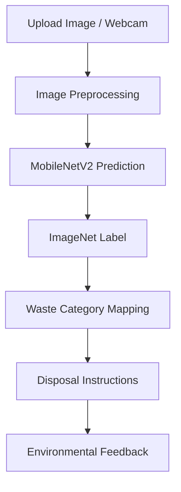

# ♻️ Smart Bin AI Assistant

### Making waste segregation smarter, one image at a time.

Smart Bin AI Assistant is an AI-powered waste identification prototype that helps users understand how to dispose of everyday waste more responsibly. Upload an image or capture one using your webcam to receive a predicted category, disposal instructions, and environmental-impact feedback.

The goal is simple: make waste segregation easier to understand and encourage more responsible disposal habits.

## 🌱 Why This Project?

Waste segregation can be confusing when people are unsure which bin an item belongs in or how electronic waste should be handled.
Smart Bin AI Assistant explores how computer vision and an interactive interface can make waste-disposal guidance more accessible.

## **live demo link:https://smart-bin-assistant-orfvdhfqoajkht246k3xpf.streamlit.app/**

## ✨ Key Features

- **📸 Image Recognition:** Capture a photo using your webcam or upload an image.
- **🤖 AI-Based Prediction:** Uses MobileNetV2 pretrained on ImageNet to identify visual objects.
- **🗑️ Waste Category Mapping:** Maps recognized object labels to supported waste categories.
- **♻️ Disposal Guidance:** Provides category-specific instructions, handling tips, and bin suggestions.
- **💻 E-Waste Awareness:** Encourages users to use appropriate electronic-waste collection channels.
- **🌍 Environmental Feedback:** Displays illustrative environmental-impact estimates during a session.
- **🌿 User-Friendly Interface:** An eco-inspired interface built with Streamlit.

## 🧠 How It Works

1. **Input:** The user uploads an image or captures one through the webcam.
2. **Preprocessing:** The image is resized and prepared for the model.
3. **Prediction:** MobileNetV2 generates ImageNet object predictions and confidence scores.
4. **Category Mapping:** Recognized labels are matched to supported waste categories.
5. **Guidance:** The application displays a predicted category, disposal instructions, and relevant tips.
6. **Feedback:** Environmental-impact estimates are displayed using predefined values.



## 🗂️ Supported Waste Categories

| Category | Example items | Guidance |
|---|---|---|
| Plastic | Bottles, plastic containers | Dry-waste disposal |
| Paper | Books, newspapers, cardboard | Keep recyclable paper dry |
| Metal | Cans, utensils, tools | Recycle safely |
| Glass | Bottles, jars | Handle carefully |
| Organic / Food | Fruit, vegetables, food scraps | Wet-waste disposal or composting |
| E-Waste | Phones, laptops, electronic devices | Use an authorised e-waste collection channel |
| Unknown | Unmatched objects | Check local disposal guidelines |

*Bin colours and collection practices can vary by location. Follow your local municipal guidelines.*

## 🛠️ Tech Stack

- **Language:** Python
- **Web Interface:** Streamlit
- **Deep Learning:** PyTorch
- **Computer Vision Model:** MobileNetV2
- **Image Processing:** Pillow, NumPy
- **Image Input:** Streamlit file uploader and camera input

## 📁 Project Structure

```text
smart-bin-assistant/
├── app.py
├── instructions.py
├── requirements.txt
├── .python-version
└── utils/
    ├── preprocessing.py
    └── prediction.py
```

- `app.py` — Main Streamlit interface and application flow.
- `instructions.py` — Waste-category mapping and disposal guidance.
- `utils/preprocessing.py` — Image preprocessing.
- `utils/prediction.py` — Model loading and image prediction.
- `requirements.txt` — Python dependencies.

## 🚀 Getting Started

### Prerequisites

- Python installed
- Git installed
- Internet access for downloading pretrained model weights on the first run, if they are not already cached

### Installation

**1. Clone the repository**

```bash
git clone https://github.com/samruddhigangane17/smart-bin-assistant.git
cd smart-bin-assistant
```

**2. Create a virtual environment**

```bash
python -m venv .venv
```

Activate it:

Windows:
```bash
.venv\Scripts\activate
```

macOS / Linux:
```bash
source .venv/bin/activate
```

**3. Install dependencies**

```bash
python -m pip install -r requirements.txt
```

**4. Run the application**

```bash
streamlit run app.py
```

Open the local URL displayed in your terminal.

## ⚙️ Technical Approach

The current prototype uses MobileNetV2 with pretrained ImageNet weights. Its predicted ImageNet labels are mapped to waste categories using predefined keyword rules.

This makes the project useful for exploring an end-to-end image-recognition workflow, but it is not equivalent to a dedicated waste-classification model trained and evaluated on a waste dataset.

## ⚠️ Limitations

- Predictions depend on the pretrained model's ability to recognise the object in the image.
- The category-mapping rules cover only selected object labels.
- Confidence scores represent the model's prediction confidence, not a guarantee that the waste category is correct.
- Environmental-impact figures are illustrative, predefined estimates and should not be interpreted as measured or independently validated savings.
- Disposal instructions may need adjustment to match local waste-management rules.

Always verify uncertain or hazardous items before disposal.

## 🔭 Future Improvements

- Train and evaluate a dedicated waste-classification model using a labelled dataset.
- Add category-level precision, recall, and F1-score measurements.
- Improve handling of mixed waste, unfamiliar objects, and low-confidence predictions.
- Add more regional languages and locally relevant disposal guidance.
- Integrate verified recycling-centre information.
- Validate environmental-impact estimates against reliable sources.

## 💡 What This Project Explores

This project brings together computer vision, image preprocessing, prediction pipelines, rule-based category mapping, and user-centred interface design to explore a practical environmental problem.

The next step is to improve classification reliability and validate the system against real-world waste images.

---

**Built with Python, PyTorch, and Streamlit ♻️**
